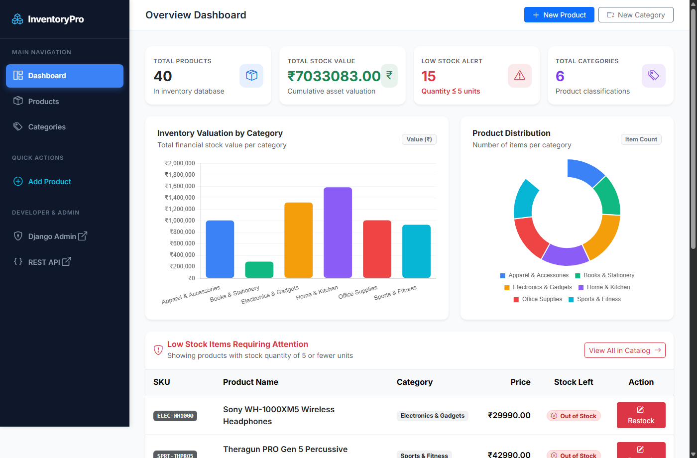
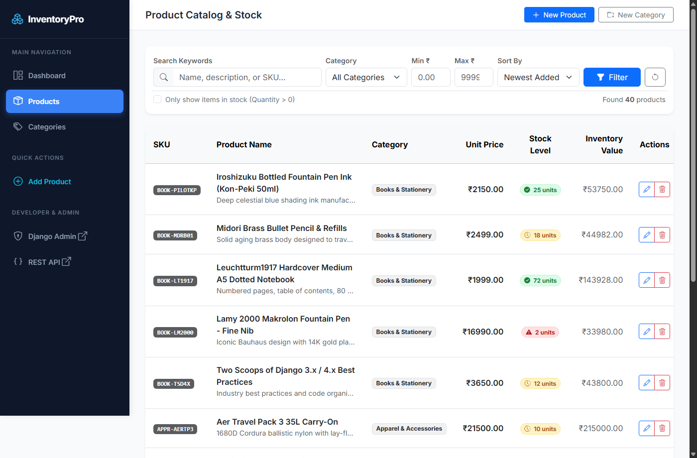
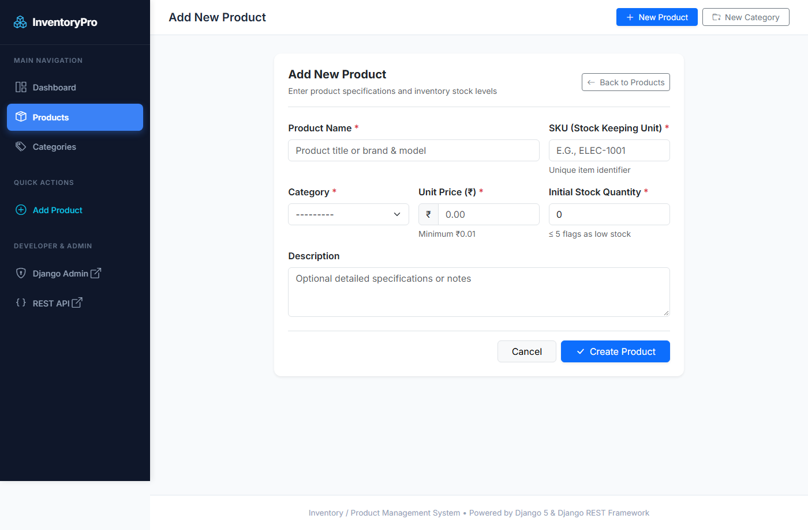
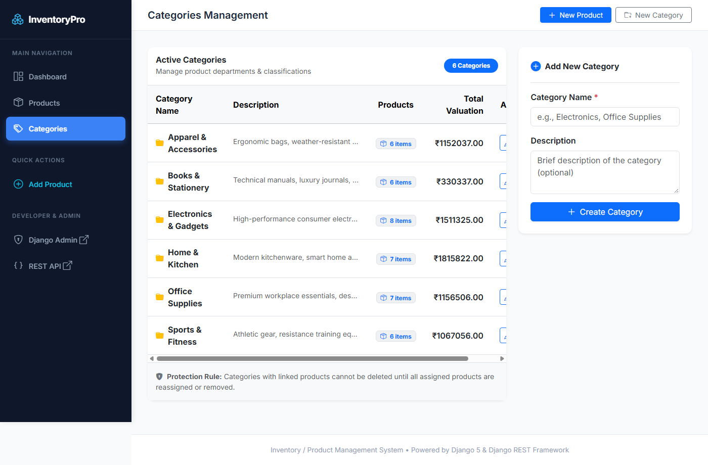

# 📦 Inventory & Stock Control Management System

[](https://www.djangoproject.com/)
[](https://www.django-rest-framework.org/)
[](https://getbootstrap.com/)
[](https://www.chartjs.org/)
[-blue?style=for-the-badge)](https://en.wikipedia.org/wiki/Indian_rupee)

An enterprise-grade, server-rendered Inventory and Product Management System developed with **Django 5**, **Django REST Framework (DRF)**, **Bootstrap 5**, and **Chart.js** featuring real-time inventory valuations, stock threshold alerts, Indian Rupee (₹) pricing, and comprehensive REST API endpoints.

---

## 🏛️ System Architecture (3–4 Lines)
> The system implements a unified **Model-View-Template (MVT) & REST API architecture**, cleanly separating database entity modeling from business logic and presentation. Data access is centralized around optimized Django ORM querysets with atomic transactions and `PROTECT` foreign key safety to prevent accidental cascade deletions. The presentation layer features server-rendered templates styled with modern Bootstrap 5 alongside a decoupled JSON API layer built on Django REST Framework viewsets for headless integration. Real-time aggregation calculates category valuations and critical stock thresholds dynamically using database-level `F()` expressions.

---

## 🌐 Live Application Preview

| Environment | URL | Details |
|---|---|---|
| **Local Web Portal** | [http://127.0.0.1:8000/](http://127.0.0.1:8000/) | Live server-rendered frontend dashboard & catalog |
| **REST API Root** | [http://127.0.0.1:8000/api/](http://127.0.0.1:8000/api/) | Interactive DRF browsable API router |
| **Django Admin** | [http://127.0.0.1:8000/admin/](http://127.0.0.1:8000/admin/) | `admin` / `admin123` |

---

## 📸 Screenshots & Visual Walkthrough

### 1. Executive Dashboard & Real-Time Analytics
*4 KPI stat cards, interactive Chart.js bar and doughnut visual charts, and a highlighted low-stock priority table.*


### 2. Product Catalog with Multi-Field Filtering & Badges
*Filter by keyword, category, price range in ₹, in-stock state, and sort orders with preserved pagination links.*


### 3. Product Specification & Inventory Entry
*Django ModelForm with server-side validation, currency adornment (₹), and inline error messages.*


### 4. Category Management & Referential Integrity Protection
*Product count metrics, cumulative category valuation, and deletion protection against orphaned records.*


---

## ✨ Features List

### 📊 1. Analytics & Executive Dashboard
- **Real-Time KPI Cards**: Total active products, aggregate stock valuation (₹), low-stock alert count, and total categories.
- **Valuation by Department (Bar Chart)**: Visual breakdown of inventory asset valuation per category calculated dynamically with `Sum(F('price') * F('stock_quantity'))`.
- **Category Item Distribution (Doughnut Chart)**: Visual share of SKUs per category.
- **Low-Stock Alert Table**: Automatically highlights items with $\le 5$ units in soft red (`low-stock-row`) with quick restock buttons.

### 🛍️ 2. Product Catalog Management
- **Multi-Criteria Search & Filter**:
  - Full-text search across `name`, `description`, and `SKU`.
  - Category selector dropdown.
  - Price range inputs (`Min ₹` and `Max ₹`).
  - "In Stock only" toggle filter (`stock_quantity > 0`).
  - Dynamic sort orders (Newest, Name A-Z/Z-A, Price Low/High, Stock Low/High).
- **Color-Coded Stock Badges**:
  - 🔴 **Red** ($\le 5$ units): Critical Low Stock
  - 🟡 **Amber** ($6 - 20$ units): Medium Reserve
  - 🟢 **Green** ($> 20$ units): Healthy Stock
- **Query-Preserving Pagination**: Seamless 10-item pagination that preserves active search and filter parameters across page clicks.

### 📝 3. Forms & Data Integrity
- **Robust ModelForms**: Clean form inputs styled with Bootstrap 5 components.
- **Server-Side Validation**: Inline error rendering for duplicate SKUs, prices below ₹0.01, and negative stock quantities.
- **Safe Deletion Protocol**: Dedicated POST confirmation dialog to prevent accidental clicks.

### 🗂️ 4. Category CRUD with Protection
- Real-time aggregation of assigned products and cumulative inventory values.
- **Referential Integrity**: Categories containing active products cannot be deleted; the UI locks the action button and displays a helpful warning banner explaining why deletion is blocked.

### ⚡ 5. Django REST Framework API
- **Router Endpoints**:
  - `/api/products/`: CRUD with search, category filtering, min/max price, in-stock toggle, sorting, and pagination.
  - `/api/categories/`: CRUD with category item counts and protected deletion.
  - `/api/dashboard/summary/`: Summary JSON payload for external dashboards.
  - `/api/dashboard/chart/`: Aggregated category stock valuation and product counts.

### 🛠️ 6. Automated Demo Seeding
- Custom management command (`python manage.py seed_demo`) creating 6 categories and 40 products with realistic pricing in Indian Rupees (₹) and varied stock levels.

---

## 🛠️ Technology Stack

| Layer | Technology | Description |
|---|---|---|
| **Backend Framework** | **Django 5.2** | High-level Python web framework with robust ORM and security |
| **API Framework** | **Django REST Framework 3.18** | Powerful toolkit for building Web APIs with serialization and viewsets |
| **Database** | **SQLite 3** | Zero-configuration SQL database engine (production-ready for standard scale) |
| **Frontend Styling** | **Bootstrap 5.3.3** | Responsive grid system, utility classes, and components |
| **Icons** | **Bootstrap Icons 1.11.3** | High-quality SVG icon set |
| **Data Visualization** | **Chart.js 4.4.2** | Flexible, responsive JavaScript charting library |
| **Language** | **Python 3.12** | Modern Python runtime |

---

## 🚀 Installation & Local Setup

### 1. Clone the Repository
```bash
git clone https://github.com/Wanderer449/inventory_system.git
cd inventory_system
```

### 2. Install Dependencies
```bash
pip install "django>=5.0,<6.0" djangorestframework
```

### 3. Run Database Migrations
```bash
python manage.py migrate
```

### 4. Seed Realistic Demo Data
```bash
python manage.py seed_demo
```

### 5. Start Development Server
```bash
python manage.py runserver
```
Visit **[http://127.0.0.1:8000/](http://127.0.0.1:8000/)** in your browser.

---

## 🔑 Default Superuser Credentials

An administrator account is pre-configured for instant access to the Django Admin portal:
- **URL**: [http://127.0.0.1:8000/admin/](http://127.0.0.1:8000/admin/)
- **Username**: `admin`
- **Password**: `admin123`

---

## 📄 License
This project is open-source and available under the [MIT License](LICENSE).
